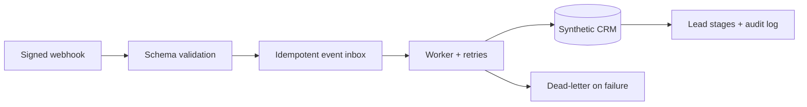

# CRM Workflow Automation Demo

**Python · FastAPI · REST API · Webhooks · SQLite · HMAC-SHA256 · Durable Retries · Docker · pytest**

An independently built portfolio demonstration of **reliable business-process automation**. A synthetic external service sends signed webhook events; a local worker turns them into CRM records, advances leads through a six-stage pipeline, tracks every action and safely retries failures.

> This project is not a copy of any commercial integration. It contains no private CRM code, customer conversations, real contact information, or credentials. **The CRM is a simulated local SQLite adapter. No real messages are sent.**

## Features

- **Signed webhook intake:** validate HMAC-SHA256 computed over the raw JSON body; reject bad signatures and invalid payloads
- **Exactly-once effect (within this demo's SQLite database):** `event_id` deduplication and transactional audit records prevent repeat CRM mutations after retries/crashes
- **Six-stage CRM workflow:** created → replied → follow-up 1 → follow-up 2 → follow-up 3 → follow-up 4
- **Durable queue:** SQLite events can be recovered even if the API process restarts
- **Retries & dead-letter:** synthetic transient errors retry with exponential backoff; permanent failures are retained as dead events
- **Observability:** `/ops/metrics`, event history, activity log and a local browser dashboard
- **Testing:** 19+ pytest tests, GitHub Actions, Docker Compose and an end-to-end CLI demo

## Workflow



[Detailed architecture and limitations](docs/architecture.md)

## Run locally

Python 3.11+:

```bash
python -m venv .venv
source .venv/bin/activate
pip install -r requirements-dev.txt
uvicorn app.api:app --host 127.0.0.1 --port 8000
```

Or via Docker Compose:

```bash
docker compose up --build
```

Open **http://127.0.0.1:8000/** for the interactive dashboard. The local demo provides fictional credentials in its UI; change both before sharing a test environment. Swagger API documentation: **http://127.0.0.1:8000/docs**.

## Walk through the browser demo

1. Click **Send signed webhook** to enqueue a fictional `lead.created` event.
2. Click **Process queue** to create a fictional CRM lead.
3. Select `lead.replied`, then send and process another event to move to stage 2.
4. Select `followup.requested` and repeat to see the stages advance.
5. Try **Fail first attempt**. After the first processing call, wait 2+ seconds and click **Process queue** again. The event is retried.
6. Try **Always fail** and repeat processing after scheduled delays to observe the dead-letter state.

You can also inspect synthetic events in [`examples/synthetic_events.json`](examples/synthetic_events.json).

## Exercise the workflow without a server

```bash
python -m scripts.demo
```

This creates a temporary SQLite database, runs creation → reply → follow-up including a simulated transient failure, and prints the final CRM stage and metrics. It makes **no network requests**.

## Signed webhook API example

The signature covers the exact bytes of the JSON body (not a re-serialized variant):

```bash
python - <<'PY'
import hashlib, hmac, json, urllib.request
body = json.dumps({
    "event_id":"demo-event-001", "lead_id":"demo-lead-001",
    "event_type":"lead.created", "display_name":"Fictional Studio",
    "source":"synthetic-webform"
}, separators=(",", ":")).encode()
signature = "sha256=" + hmac.new(b"local-demo-webhook-change-me", body, hashlib.sha256).hexdigest()
req = urllib.request.Request("http://127.0.0.1:8000/webhooks/events", body,
    headers={"Content-Type":"application/json", "X-Demo-Signature":signature})
print(urllib.request.urlopen(req).read().decode())
PY

curl -X POST http://127.0.0.1:8000/ops/process \
  -H 'Content-Type: application/json' \
  -H 'X-Admin-Token: local-demo-admin-change-me' \
  -d '{"limit":10}'
```

## Tests

```bash
python -m pytest -q
python -m compileall -q app scripts
python -m scripts.demo
```

## What's intentionally *not* included

No real CRM adapter or external API credentials, no outbound messages, no real customer data, no scheduler, no production-grade authorization, no distributed queue and no deployment beyond localhost. The open-source-looking code is an **independent work sample**, not a claim that this exact repository ran for a real client. See [limitations](docs/architecture.md) before adapting the idea for a real service.
