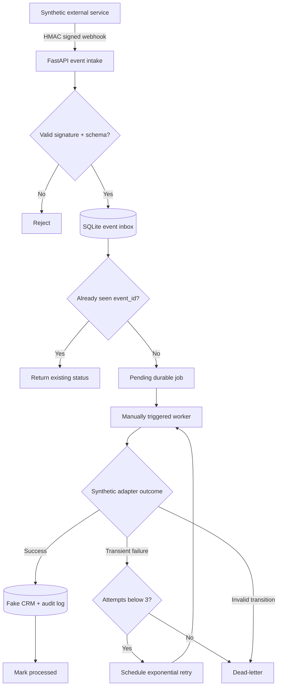

# Architecture and engineering trade-offs

## Why the demonstration uses a durable event queue

Webhook providers can retry deliveries and may send duplicate events. Each inbound event has a stable `event_id` primary key; repeated delivery is accepted without duplicating work. The event is stored before returning HTTP 200. A worker claims one due event in a SQLite `BEGIN IMMEDIATE` transaction to avoid two workers claiming it at once.

The synthetic CRM mutation and its audit row are committed **in a single database transaction**. The audit table also has a unique `event_id` constraint. If the worker dies after writing the simulated CRM update but before marking the inbox event as processed, the reclaimed event detects that the mutation already occurred.

## Failure handling

- **Transient synthetic adapter failure:** 2 seconds after the first failed attempt, 4 seconds after the second; after the third, move to the `dead` state.
- **Permanent workflow failure:** e.g. a reply arrives before the lead exists or a follow-up is attempted while the lead is still new → `dead` without retries.
- **Worker death:** jobs with a 30-second-expired processing lease may be reclaimed, with the audit log preventing duplicate state transitions.
- **Repeated create event for an existing lead:** never resets that lead's stage. A separate audit entry records the ignored create.
- **No automatic contact with customers:** a follow-up is **recorded in the fake CRM** only. The demo does not send messages, email, or make external CRM API calls.

## Stages

| Stage | Meaning |
| --- | --- |
| 1 | `new` |
| 2 | `replied` |
| 3 | `follow_up_1` |
| 4 | `follow_up_2` |
| 5 | `follow_up_3` |
| 6 | `follow_up_4` |

## Production considerations

The application is a **localhost-only, single-instance portfolio demonstration**, not production-ready. Notably:

- The example shared tokens are intentionally public; replace before even a shared test instance. Use HTTPS, secret rotation, request timestamps/nonces, network restrictions and rate limiting for real integrations.
- The API is bound to `127.0.0.1` via Docker Compose. Do **not** expose it on the internet as-is.
- In a larger deployment, replace SQLite with PostgreSQL and a durable task scheduler/worker process. Implement monitoring, alerts, dead-letter repair tooling, migrations, backup/restore exercises and operational dashboards.
- Real CRM integration requires an isolated adapter, credential vault, API rate-limit handling, permission scopes, and integration tests with a dedicated sandbox CRM.
- A background worker/scheduler is intentionally absent. `POST /ops/process` runs the queue only when an operator triggers it.
- This demo simulates failures deterministically; it does not benchmark real provider outages or verify actual delivery guarantees.
- HTTP `200` confirms intake into the local database, **not** that CRM processing has completed.

## Privacy

All bundled events and examples are **fictional**. No client data, private message history, contacts, commercial scoring rules, tokens, or code from actual internal CRM projects are included.
